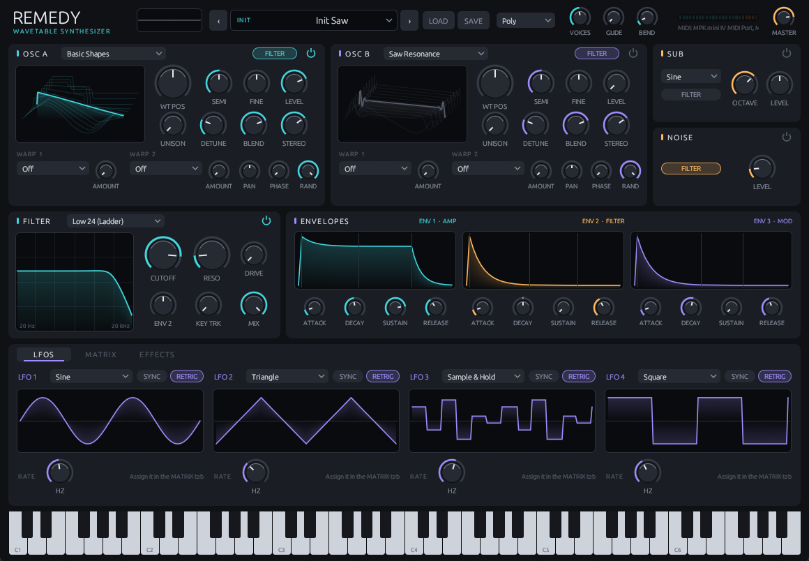
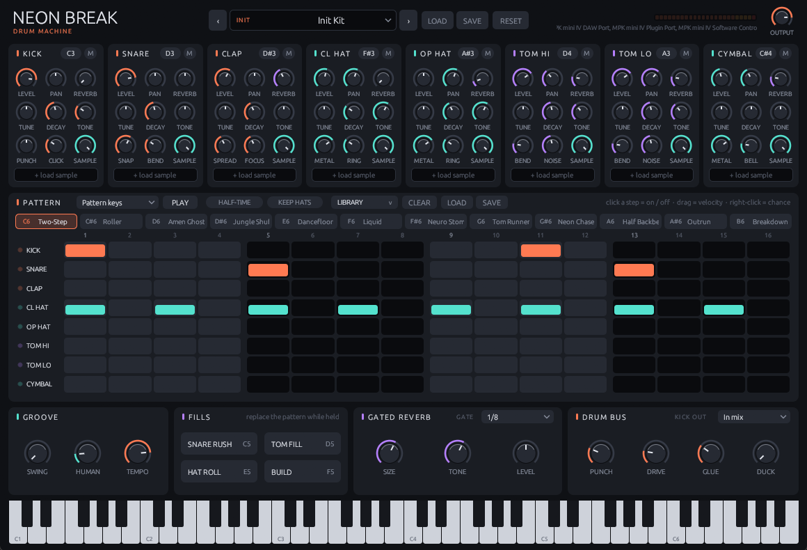
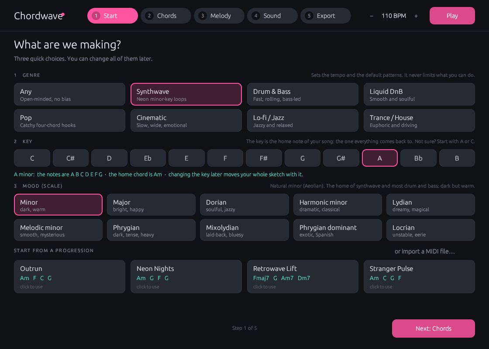
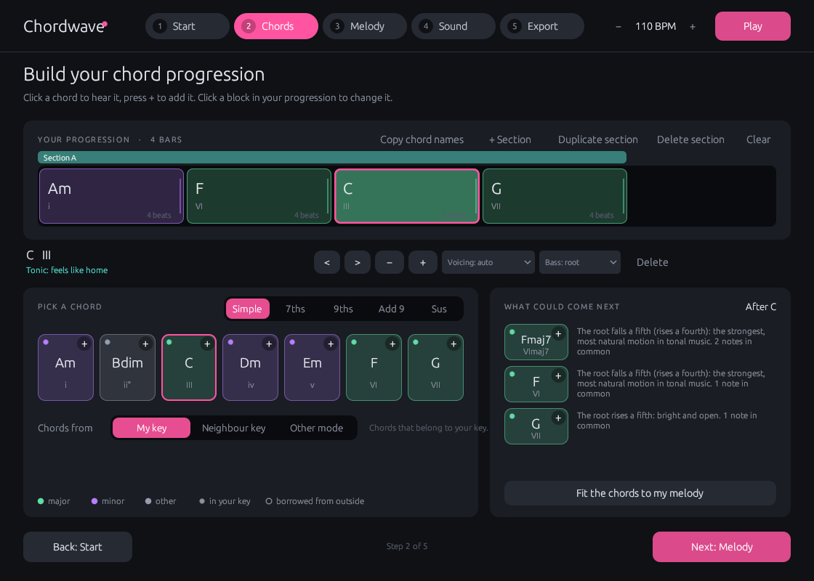
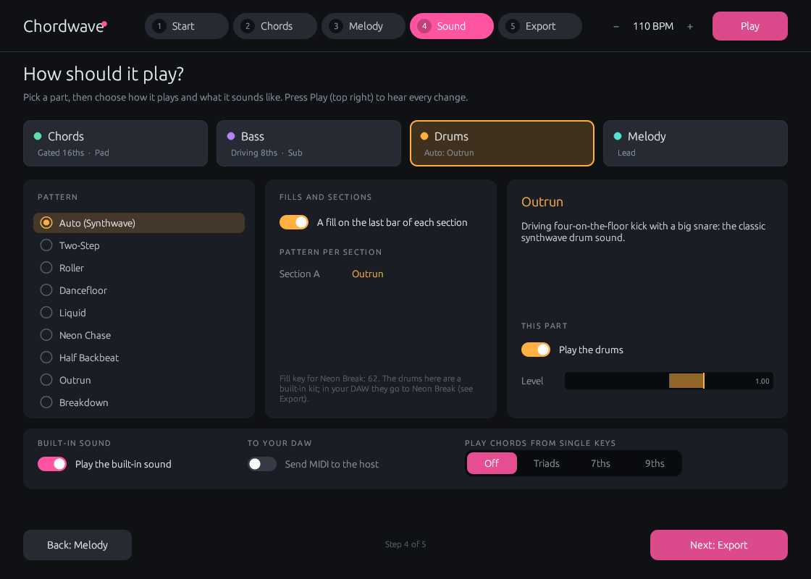
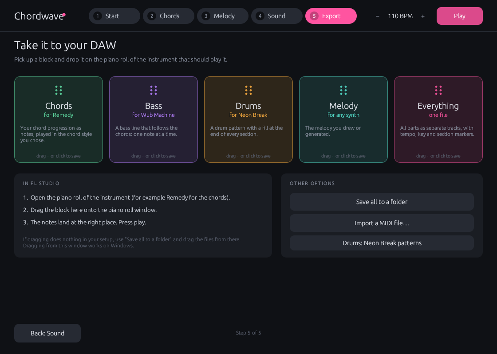

# Hodiloves Instruments

Free, open-source instruments for **synthwave and drum and bass**: neon pads and wavetables, rolling
wobble basses, 80s gated-reverb breaks and a chord and melody sketcher. Two synthesizers, a drum machine
and a songwriting tool, written in Rust with [nih-plug](https://github.com/robbert-vdh/nih-plug). Each
builds as **VST3**, **CLAP** and a **standalone** app.

## The plugins

### Remedy: wavetable synthesizer



A polyphonic wavetable synth for pads, leads and plucks. Two oscillators scan through procedurally
generated wavetables, with up to 16 voices of unison, 11 warp modes, a sub oscillator and noise. The sound
goes through a multi-mode filter, three envelopes, four LFOs and a modulation matrix, then an effects
rack (distortion, chorus, delay, reverb). Source: `plugins/remedy`.

### Wub Machine: wobble bass


A monophonic bass synth built for dubstep and drum and bass. A unison saw oscillator (plus an FM-capable
second oscillator and a sub) feeds a resonant ladder filter that a tempo-synced LFO opens and closes: that
is the "wub", and a second LFO adds the growl. Vowel-style formant filtering, two distortion stages and an
OTT-style multiband compressor add bite. A 16-step pattern gives every step its own wobble depth, speed
and pitch, and 40 factory presets cover the common wobble, Reese and growl sounds. Source: `plugins/wubmachine`.

### Neon Break: drum machine



An 80s-style drum machine for synthwave and drum and bass, played entirely from the piano roll: drum
notes, fill keys and twelve pattern slots. Eight synthesized drums can each be replaced or layered with
your own samples (WAV, Ogg Vorbis or WavPack, loaded by click or drag and drop). It has a gated reverb, a
drum bus and a separate kick output for sidechaining. Details are further down. Source: `plugins/neonbreak`.

### Chordwave: chord, bass and melody sketcher


A guided, five-step songwriting helper in the spirit of chord-palette tools. Pick a key and scale and Chordwave shows only
the chords that belong there, colour-coded and explained. Build a progression by dragging chords into a
sequence, let the suggestion engine tell you what could come next **and why**, generate a bassline and a
melody that follow the chords, then get it all into your DAW as a MIDI file (or as live MIDI). Details are
further down, the music theory behind it is in [`plugins/chordwave/THEORY.md`](plugins/chordwave/THEORY.md).
Source: `plugins/chordwave`.

## Layout

```
Cargo.toml            workspace (shared dependency versions, release profile)
bundler.toml          display names of the bundles
plugins/remedy        Remedy
plugins/wubmachine    Wub Machine
plugins/neonbreak     Neon Break
plugins/chordwave     Chordwave
crates/common         shared code: DSP helpers (envelope, decimator, tanh...) and egui widgets (knob, combo...)
xtask                 `cargo xtask bundle <plugin> --release`
```

Adding a plugin = a new folder under `plugins/`, a line in the root `Cargo.toml` members, and a
`[crate_name]` entry in `bundler.toml`.

## Build

Requirements: Rust (stable) and the MSVC build tools on Windows.

```bash
cargo xtask bundle remedy --release
```

```bash
cargo xtask bundle wubmachine --release
```

```bash
cargo xtask bundle neonbreak --release
```

```bash
cargo xtask bundle chordwave --release
```

Output goes to `target/bundled/`:

- `Remedy.vst3`, `Wub Machine.vst3`, `Neon Break.vst3`, `Chordwave.vst3` (a folder: `Name.vst3\Contents\x86_64-win\Name.vst3`)
- `Remedy.clap`, `Wub Machine.clap`, `Neon Break.clap`, `Chordwave.clap`
- `Remedy.exe`, `Wub Machine.exe`, `Neon Break.exe`, `Chordwave.exe` (standalone apps)

Run tests:

```bash
cargo test --release --workspace --lib
```

Run a plugin without a DAW (opens the UI and uses WASAPI audio/MIDI):

```bash
cargo run --release --bin wubmachine-standalone
```

## Installing the VST3 (FL Studio and others) on Windows

Copy the whole `.vst3` **folder** into `C:\Program Files\Common Files\VST3\` (needs administrator rights),
then rescan in your DAW. In FL Studio use *Options > Manage plugins > Find installed plugins*.
Do not add the folder inside the bundle (`...\Contents\x86_64-win`) as a search path, and make sure the
search path is of type **VST3**, not VST.

```powershell
Copy-Item -Recurse -Force "target\bundled\Wub Machine.vst3" "C:\Program Files\Common Files\VST3\"
```

**Linux/MacOS versions are untested!**

## Neon Break in short

Everything is played from the piano roll. Note names below are FL Studio's (MIDI note 60 = C5).

| Keys | MIDI notes | What a note does |
|---|---|---|
| C3 and up | 36 kick, 38 snare, 39 clap, 42 / 46 hats, 50 / 45 toms, 49 cymbal | One hit; velocity = how hard |
| C5, D5, E5, F5 | 60, 62, 64, 65 | Plays a fill for as long as the note lasts (snare rush, tom fill, hat roll, build). The pattern stops meanwhile |
| C6 to B6 | 72 to 83 | Plays pattern slot 1 to 12 for as long as the note lasts |

- **Eight drums**: kick, snare, clap, closed and open hat, two toms, cymbal. Each is synthesized, and
  each can load a WAV sample instead; the SAMPLE knob blends between the two.
- **Twelve pattern slots**, sixteen steps per drum with velocity and chance per step. Each slot can be
  half-time (its steps last two bars), optionally with the hats kept at full speed. The slots are
  saved with the project and in preset files; single slots can be saved and loaded as pattern files.
- **Pattern mode**: *Pattern keys* (default) plays a slot only while its key is held; *Always on* plays
  the selected slot whenever the host plays; *Off* is a plain drum module. PLAY auditions the selected
  slot (and is the transport of the standalone app, with TEMPO).
- **Kick output**: a second stereo output carries only the kick, for sidechaining (KICK OUT in the drum
  bus panel: in mix, mix + copy, or separate). In FL Studio enable it in the wrapper's Processing tab.
- **Gated reverb** with a tempo-synced gate, and a **drum bus** with punch, drive, glue and kick ducking.

## Chordwave in short

Chordwave is a sketchpad, not a sound source: it writes the notes (chords, bass, melody) and helps you
get them into the instruments you already use. It has a small built-in synth so you can hear ideas
immediately.

It walks you through five steps (the buttons at the top, and Back / Next at the bottom). Play is always in
the top right.

| | |
|---|---|
|  |  |
|  |  |
|  | |

1. **Start**: pick a genre, a key and a mood. The key is explained ("the home note of your song") and a live
   line shows its notes and home chord. All ten scales are listed with how they feel (dark and warm, dreamy,
   exotic...). Or begin from a ready-made progression for the genre, written in your key, with an explanation
   of why it works. Picking a genre also sets the tempo and sensible patterns; nothing is locked to it.
2. **Chords**: your progression as large blocks. Below it, the seven chords of your key (Simple, 7ths, 9ths,
   Add 9 or Sus): click to hear, **+** to add. *Chords from* lets you borrow from a neighbouring key (circle of
   fifths) or another mode. *What could come next* ranks the chords that fit after the selected one and says
   why in plain words. Select a block to move it, lengthen it, set its voicing or a slash bass note; sections
   (verse, chorus...) can be duplicated, and the melody moves with the chords.
3. **Melody**: a big piano roll with numbered bars, beats, labelled rows and the chords above it. By default
   only the notes of your key are shown, so every note you place fits (switch to *All notes* any time). Notes
   are coloured: fits the chord, passing note, outside the key. Adding a note pulses, removing one fades out
   with a message, and a note has a hover **x** to delete it. The wheel scrolls up and down (Shift + wheel
   sideways) and there are scrollbars. Six generate **styles**, each explained: *Hook* (a singable tune),
   *Riff* (one pattern repeated on every chord), *Arpeggio*, *Long notes*, *Call & answer*, and *Re-pitch mine*
   (keeps the rhythm you drew and picks new notes). *Busy* sets how many notes.
4. **Sound**: one part at a time (Chords, Bass, Drums, Melody). Choose how it plays and what it sounds like;
   hovering any option explains it. Chords have 7 patterns and 5 sounds, the bass 7 patterns and 3 sounds,
   the melody 4 sounds, and each part has a level and a mute. **Drums** are played by a built-in kit (kick,
   snare, clap, hats, toms, cymbal) with 8 patterns from Neon Break (or *Auto* for the genre) and fills at the
   end of each section.
5. **Export**: drag a block into your DAW, see below.

**Getting it into your DAW**

- **Drag a block into the piano roll.** The *Export* step has five blocks. Pick one up and drop it on a
  channel's piano roll, a channel or the Playlist (in FL Studio, onto the piano roll of the instrument that
  should play it). A click on a block saves the file instead. Dragging works on **Windows** (it is the same file
  drag as from Explorer); on other systems the blocks save a file. It is untested in a real FL Studio here:
  if a drop does nothing in your host, use *Quick export* and drag the file from the folder.
- **Shortcuts for the instruments of this pack**: each block is shaped for one of them.

  | Block | Made for | What is in the file |
  |---|---|---|
  | CHORDS | Remedy | the chord part (chord style, voicing, octave), polyphonic |
  | BASS | Wub Machine | the bass line, one note at a time, in the genre's bass range |
  | DRUMS | Neon Break | **Keys**: Neon Break's own pattern-slot keys (one per section, a fill key over the last bar) so it plays *its* patterns; **Plain notes**: the same patterns as ordinary drum notes (36 kick, 38 snare, 42 / 46 hats...) for any drum machine, with a crash at each new section |
  | MELODY | any synth | the piano-roll melody |
  | ALL PARTS | a DAW session | one file with tempo, key, a marker per section and Chords / Bass / Melody tracks |

  The drum patterns follow the genre (synthwave: *Outrun* and *Neon Chase*; drum and bass: *Two-Step* and
  *Roller*; liquid: *Liquid*, and so on), alternating between sections. Keep Neon Break's pattern mode on
  *Pattern keys* (its default) for the keys version.
- **Quick export to folder** writes every file into `Documents/Chordwave` and opens the folder.
- **Import MIDI** loads a file (a melody, a bass line, a chord part) to set it as the melody or to detect its
  chords bar by bar, and suggests the key.
- **MIDI out**: the plugin sends its notes to the host (chords on channel 1, bass on 2, melody on 3, drums on
  channel 10, the General MIDI drum channel that Neon Break understands), so they can be routed to any instrument. How plugin MIDI output is exposed differs between hosts; if yours cannot do
  it, use the blocks.
- **Keyboard**: set *Keyboard* to *Chords* and a single key plays the diatonic chord built on it (notes outside
  the scale are ignored): a quick way to jam ideas in key. Playback follows the host transport, or the PLAY
  button.

## Licence

Copyright (C) Hodiloves. Licensed under the **GNU General Public License v3.0 or later**: see
[LICENSE](LICENSE). `vendor/egui-baseview` is a patched copy of
[egui-baseview](https://github.com/BillyDM/egui-baseview) (MIT, see its own `LICENSE`).

### Licence note

nih-plug itself is ISC-licensed, but its VST3 bindings are GPLv3, so a VST3 build must be distributed under
GPLv3-compatible terms (hence `GPL-3.0-or-later` in the manifests). A CLAP-only build avoids that constraint.
