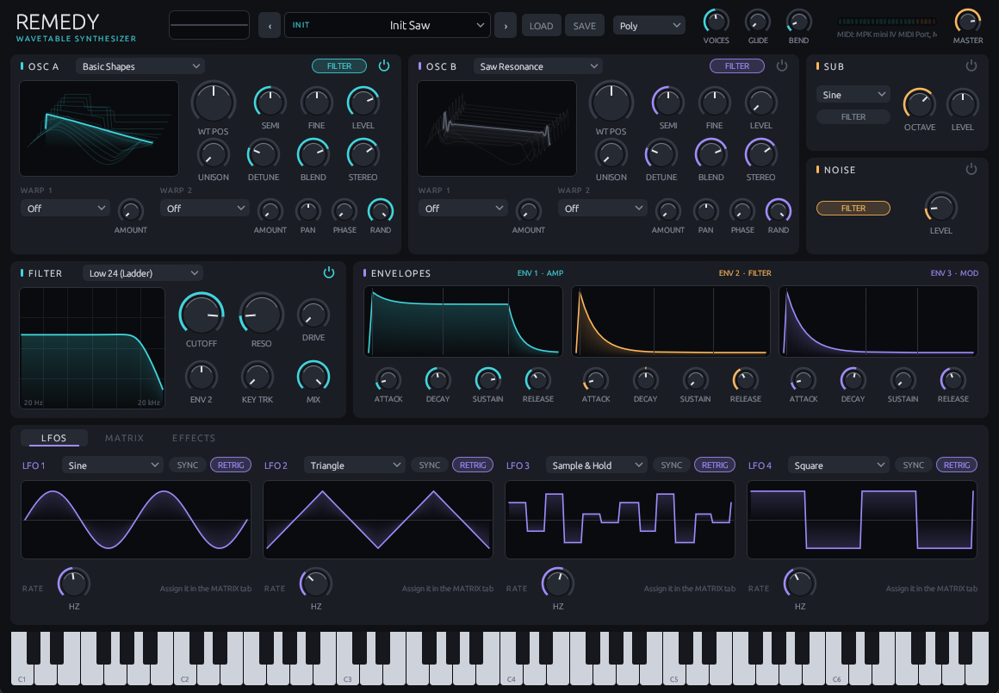
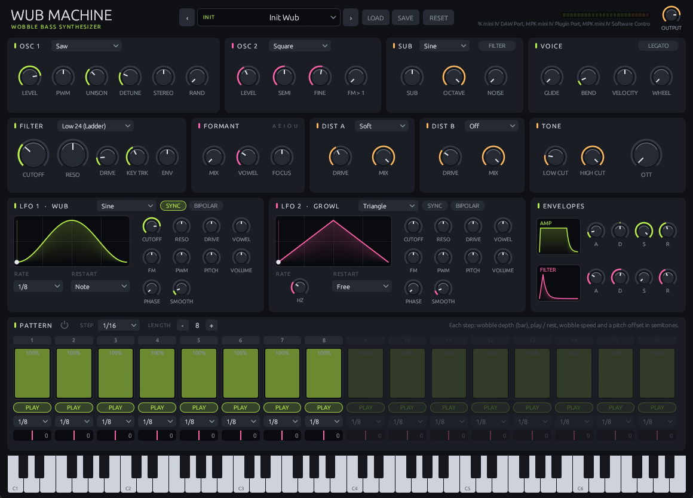
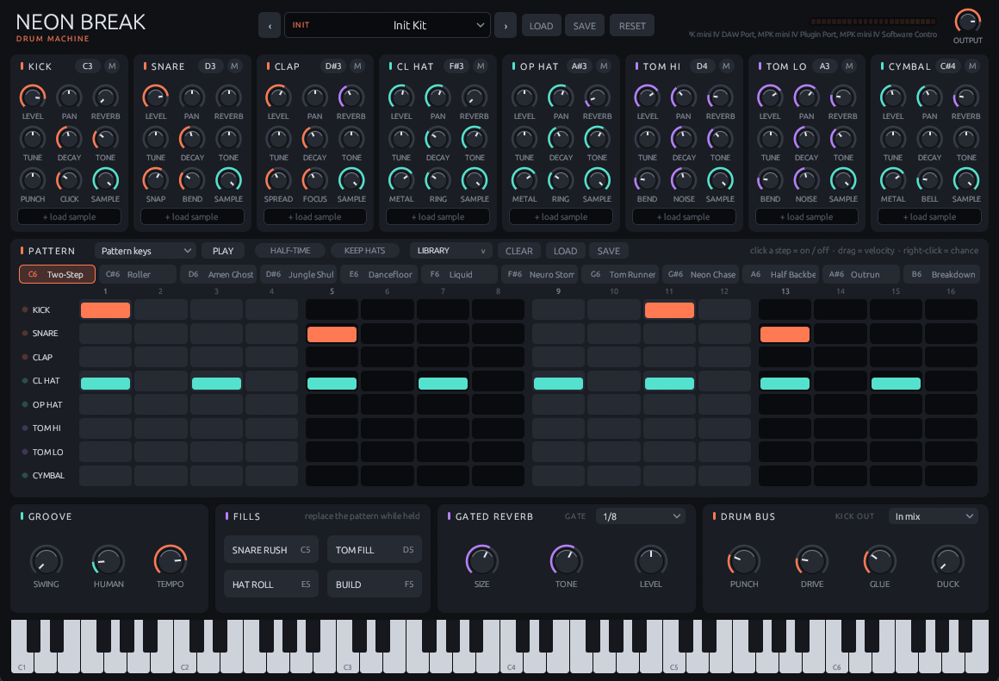

# Hodiloves Instruments

Free, open-source instruments for **synthwave and drum and bass**: neon pads and wavetables, rolling
wobble basses and 80s gated-reverb breaks. Two synthesizers and a drum machine, written in Rust with
[nih-plug](https://github.com/robbert-vdh/nih-plug). Each builds as **VST3**, **CLAP** and a **standalone** app.

## The plugins

### Remedy: wavetable synthesizer



A polyphonic wavetable synth for pads, leads and plucks. Two oscillators scan through procedurally
generated wavetables, with up to 16 voices of unison, 11 warp modes, a sub oscillator and noise. The sound
goes through a multi-mode filter, three envelopes, four LFOs and a modulation matrix, then an effects
rack (distortion, chorus, delay, reverb). Source: `plugins/remedy`.

### Wub Machine: wobble bass



A monophonic bass synth built for dubstep and drum and bass. A unison saw oscillator (plus an FM-capable
second oscillator and a sub) feeds a resonant ladder filter that a tempo-synced LFO opens and closes: that
is the "wub", and a second LFO adds the growl. Vowel-style formant filtering, two distortion stages and an
OTT-style multiband compressor add bite. A 16-step pattern gives every step its own wobble depth, speed
and pitch, and 40 factory presets cover the common wobble, Reese and growl sounds. Source: `plugins/wubmachine`.

### Neon Break: drum machine



An 80s-style drum machine for synthwave and drum and bass, played entirely from the piano roll: drum
notes, fill keys and twelve pattern slots. Eight synthesized drums can each be replaced or layered with
your own samples (WAV, Ogg Vorbis or WavPack, loaded by click or drag and drop). It has a gated reverb, a
drum bus and a separate kick output for sidechaining. Details are further down. Source: `plugins/neonbreak`.

## Layout

```
Cargo.toml            workspace (shared dependency versions, release profile)
bundler.toml          display names of the bundles
plugins/remedy        Remedy
plugins/wubmachine    Wub Machine
plugins/neonbreak     Neon Break
crates/common         shared code: DSP helpers (envelope, decimator, tanh...) and egui widgets (knob, combo...)
xtask                 `cargo xtask bundle <plugin> --release`
```

Adding a plugin = a new folder under `plugins/`, a line in the root `Cargo.toml` members, and a
`[crate_name]` entry in `bundler.toml`.

## Build

Requirements: Rust (stable) and the MSVC build tools on Windows.

```bash
cargo xtask bundle remedy --release
```

```bash
cargo xtask bundle wubmachine --release
```

```bash
cargo xtask bundle neonbreak --release
```

Output goes to `target/bundled/`:

- `Remedy.vst3`, `Wub Machine.vst3`, `Neon Break.vst3` (a folder: `Name.vst3\Contents\x86_64-win\Name.vst3`)
- `Remedy.clap`, `Wub Machine.clap`, `Neon Break.clap`
- `Remedy.exe`, `Wub Machine.exe`, `Neon Break.exe` (standalone apps)

Run tests:

```bash
cargo test --release --workspace --lib
```

Run a plugin without a DAW (opens the UI and uses WASAPI audio/MIDI):

```bash
cargo run --release --bin wubmachine-standalone
```

## Installing the VST3 (FL Studio and others)

Copy the whole `.vst3` **folder** into `C:\Program Files\Common Files\VST3\` (needs administrator rights),
then rescan in your DAW. In FL Studio use *Options > Manage plugins > Find installed plugins*.
Do not add the folder inside the bundle (`...\Contents\x86_64-win`) as a search path, and make sure the
search path is of type **VST3**, not VST.

```powershell
Copy-Item -Recurse -Force "target\bundled\Wub Machine.vst3" "C:\Program Files\Common Files\VST3\"
```

## Neon Break in short

Everything is played from the piano roll. Note names below are FL Studio's (MIDI note 60 = C5).

| Keys | MIDI notes | What a note does |
|---|---|---|
| C3 and up | 36 kick, 38 snare, 39 clap, 42 / 46 hats, 50 / 45 toms, 49 cymbal | One hit; velocity = how hard |
| C5, D5, E5, F5 | 60, 62, 64, 65 | Plays a fill for as long as the note lasts (snare rush, tom fill, hat roll, build). The pattern stops meanwhile |
| C6 to B6 | 72 to 83 | Plays pattern slot 1 to 12 for as long as the note lasts |

- **Eight drums**: kick, snare, clap, closed and open hat, two toms, cymbal. Each is synthesized, and
  each can load a WAV sample instead; the SAMPLE knob blends between the two.
- **Twelve pattern slots**, sixteen steps per drum with velocity and chance per step. Each slot can be
  half-time (its steps last two bars), optionally with the hats kept at full speed. The slots are
  saved with the project and in preset files; single slots can be saved and loaded as pattern files.
- **Pattern mode**: *Pattern keys* (default) plays a slot only while its key is held; *Always on* plays
  the selected slot whenever the host plays; *Off* is a plain drum module. PLAY auditions the selected
  slot (and is the transport of the standalone app, with TEMPO).
- **Kick output**: a second stereo output carries only the kick, for sidechaining (KICK OUT in the drum
  bus panel: in mix, mix + copy, or separate). In FL Studio enable it in the wrapper's Processing tab.
- **Gated reverb** with a tempo-synced gate, and a **drum bus** with punch, drive, glue and kick ducking.

## Licence

Copyright (C) Hodiloves. Licensed under the **GNU General Public License v3.0 or later**: see
[LICENSE](LICENSE). `vendor/egui-baseview` is a patched copy of
[egui-baseview](https://github.com/BillyDM/egui-baseview) (MIT, see its own `LICENSE`).

### Licence note

nih-plug itself is ISC-licensed, but its VST3 bindings are GPLv3, so a VST3 build must be distributed under
GPLv3-compatible terms (hence `GPL-3.0-or-later` in the manifests). A CLAP-only build avoids that constraint.
