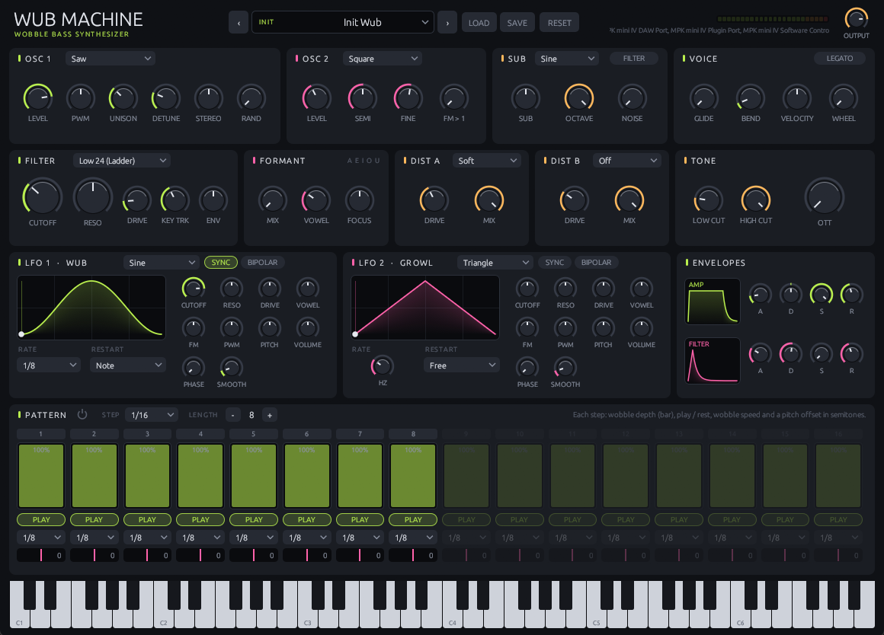
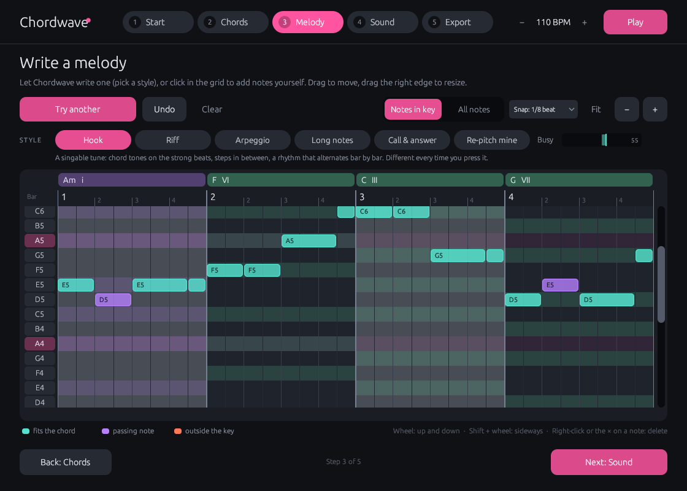

# Hodiloves Instruments

Free, open-source instruments for **synthwave and drum and bass**: neon pads and wavetables, rolling
wobble basses, 80s gated-reverb breaks and a chord and melody sketcher. Two synthesizers, a drum machine
and a songwriting tool, written in Rust with [nih-plug](https://github.com/robbert-vdh/nih-plug). Each
builds as **VST3**, **CLAP** and a **standalone** app.

## The plugins

### Remedy: wavetable synthesizer


A polyphonic wavetable synth for pads, leads and plucks. Two oscillators scan through procedurally
generated wavetables, with up to 16 voices of unison, 11 warp modes, a sub oscillator and noise. The sound
goes through a multi-mode filter, three envelopes, four LFOs and a modulation matrix, then an effects
rack (distortion, chorus, delay, reverb). Source: `plugins/remedy`.

### Wub Machine: wobble bass



A monophonic bass synth built for dubstep and drum and bass. A unison saw oscillator (plus an FM-capable
second oscillator and a sub) feeds a resonant ladder filter that a tempo-synced LFO opens and closes: that
is the "wub", and a second LFO adds the growl. Vowel-style formant filtering, two distortion stages and an
OTT-style multiband compressor add bite. A 16-step pattern gives every step its own wobble depth, speed
and pitch, and 40 factory presets cover the common wobble, Reese and growl sounds. Source: `plugins/wubmachine`.

### Neon Break: drum machine


An 80s-style drum machine for synthwave and drum and bass, played entirely from the piano roll: drum
notes, fill keys and twelve pattern slots. Eight synthesized drums can each be replaced or layered with
your own samples (WAV, Ogg Vorbis or WavPack, loaded by click or drag and drop). It has a gated reverb, a
drum bus and a separate kick output for sidechaining. Details are further down. Source: `plugins/neonbreak`.

### Chordwave: chord, bass and melody sketcher



A songwriting helper in the spirit of chord-palette tools. Pick a key and scale and Chordwave shows only
the chords that belong there, colour-coded and explained. Build a progression by dragging chords into a
sequence, let the suggestion engine tell you what could come next **and why**, generate a bassline and a
melody that follow the chords, then get it all into your DAW as a MIDI file (or as live MIDI). Details are
further down, the music theory behind it is in [`plugins/chordwave/THEORY.md`](plugins/chordwave/THEORY.md).
Source: `plugins/chordwave`.

## Layout

```
Cargo.toml            workspace (shared dependency versions, release profile)
bundler.toml          display names of the bundles
plugins/remedy        Remedy
plugins/wubmachine    Wub Machine
plugins/neonbreak     Neon Break
plugins/chordwave     Chordwave
crates/common         shared code: DSP helpers (envelope, decimator, tanh...) and egui widgets (knob, combo...)
xtask                 `cargo xtask bundle <plugin> --release`
```

Adding a plugin = a new folder under `plugins/`, a line in the root `Cargo.toml` members, and a
`[crate_name]` entry in `bundler.toml`.

## Build

Requirements: Rust (stable) and the MSVC build tools on Windows.

```bash
cargo xtask bundle remedy --release
```

```bash
cargo xtask bundle wubmachine --release
```

```bash
cargo xtask bundle neonbreak --release
```

```bash
cargo xtask bundle chordwave --release
```

Output goes to `target/bundled/`:

- `Remedy.vst3`, `Wub Machine.vst3`, `Neon Break.vst3`, `Chordwave.vst3` (a folder: `Name.vst3\Contents\x86_64-win\Name.vst3`)
- `Remedy.clap`, `Wub Machine.clap`, `Neon Break.clap`, `Chordwave.clap`
- `Remedy.exe`, `Wub Machine.exe`, `Neon Break.exe`, `Chordwave.exe` (standalone apps)

Run tests:

```bash
cargo test --release --workspace --lib
```

Run a plugin without a DAW (opens the UI and uses WASAPI audio/MIDI):

```bash
cargo run --release --bin wubmachine-standalone
```

## Installing the VST3 (FL Studio and others) on Windows

Copy the whole `.vst3` **folder** into `C:\Program Files\Common Files\VST3\` (needs administrator rights),
then rescan in your DAW. In FL Studio use *Options > Manage plugins > Find installed plugins*.
Do not add the folder inside the bundle (`...\Contents\x86_64-win`) as a search path, and make sure the
search path is of type **VST3**, not VST.

```powershell
Copy-Item -Recurse -Force "target\bundled\Wub Machine.vst3" "C:\Program Files\Common Files\VST3\"
```

**Linux/MacOS versions are untested!**

## Neon Break in short

Everything is played from the piano roll. Note names below are FL Studio's (MIDI note 60 = C5).

| Keys | MIDI notes | What a note does |
|---|---|---|
| C3 and up | 36 kick, 38 snare, 39 clap, 42 / 46 hats, 50 / 45 toms, 49 cymbal | One hit; velocity = how hard |
| C5, D5, E5, F5 | 60, 62, 64, 65 | Plays a fill for as long as the note lasts (snare rush, tom fill, hat roll, build). The pattern stops meanwhile |
| C6 to B6 | 72 to 83 | Plays pattern slot 1 to 12 for as long as the note lasts |

- **Eight drums**: kick, snare, clap, closed and open hat, two toms, cymbal. Each is synthesized, and
  each can load a WAV sample instead; the SAMPLE knob blends between the two.
- **Twelve pattern slots**, sixteen steps per drum with velocity and chance per step. Each slot can be
  half-time (its steps last two bars), optionally with the hats kept at full speed. The slots are
  saved with the project and in preset files; single slots can be saved and loaded as pattern files.
- **Pattern mode**: *Pattern keys* (default) plays a slot only while its key is held; *Always on* plays
  the selected slot whenever the host plays; *Off* is a plain drum module. PLAY auditions the selected
  slot (and is the transport of the standalone app, with TEMPO).
- **Kick output**: a second stereo output carries only the kick, for sidechaining (KICK OUT in the drum
  bus panel: in mix, mix + copy, or separate). In FL Studio enable it in the wrapper's Processing tab.
- **Gated reverb** with a tempo-synced gate, and a **drum bus** with punch, drive, glue and kick ducking.

## Chordwave in short

Chordwave is a sketchpad, not a sound source: it writes the notes (chords, bass, melody) and helps you
get them into the instruments you already use. It has a small built-in synth so you can hear ideas
immediately.

**Workflow**: choose key, scale and genre, then

1. **Palette**: every chord of the key as a grid (triads, 7ths, 9ths, sus2, sus4, add9). Green is major-ish,
   purple is minor-ish, grey is everything else (sus, diminished, augmented). A filled dot means the chord is
   fully inside the key, a hollow dot means it borrows a note. Click to listen, double-click to add, or drag
   it onto the sequence. *Adjacent keys* steps along the circle of fifths (more steps = more exotic chords),
   *Parallel mode* borrows from another mode on the same tonic (modal interchange).
2. **Ideas**: *Next chord* ranks what could follow the selected chord and gives the music-theory reason
   (root motion, notes in common, tension and release, typical moves of the chosen genre). *Match melody*
   lists the chords that fit your melody notes, guesses the key, and can re-harmonise the whole sketch around
   a melody. *Progressions* has ready-made loops for synthwave, drum and bass, liquid, pop, cinematic, lo-fi and
   trance, written in your key, each with an explanation of why it works.
3. **Sequence**: chords as blocks in sections (verse, chorus...). Drag to reorder, drag the right edge to change
   the length, set the inversion (or let it pick the smoothest voice leading) and a slash bass note. Duplicate
   a section to repeat it. The melody moves with the chords when you insert, delete or resize them.
4. **Piano roll**: draw the melody on top of the harmony. Scale notes are lit, the chord tones of the chord
   under each note glow, and every note is coloured: chord tone, scale tone or outside the scale. **Generate**
   writes a hook with chord tones on the strong beats, stepwise motion in between, a repeating rhythm and a
   resolving end (density and register are adjustable); *Snap to key* fixes stray notes.
5. **Parts**: the chords can be played as held pads, 8th pulses, offbeat or syncopated stabs, gated 16ths or
   arpeggios; the bass as sustained roots, driving 8ths, octave bounce, offbeat roots or drum and bass
   two-step and rolling patterns. Picking a genre sets sensible defaults, nothing is locked.

**Getting it into your DAW**

- **SAVE MIDI**: one standard MIDI file with the tempo, the key signature, a marker per section and separate
  *Chords*, *Bass* and *Melody* tracks (also each part on its own). Drag it onto a track in the DAW.
- **QUICK EXPORT TO FOLDER** writes all four files into `Documents/Chordwave` and opens the folder.
- **IMPORT MIDI** loads a file (a melody, a bass line, a chord part) to set it as the melody or to detect its
  chords bar by bar, and suggests the key.
- **MIDI OUT**: the plugin sends its notes to the host (chords on channel 1, bass on 2, melody on 3), so they
  can be routed to any instrument. How plugin MIDI output is exposed differs between hosts; if yours cannot do
  it, use the MIDI export.
- **Keyboard**: set *Keyboard* to *Chords* and a single key plays the diatonic chord built on it (notes outside
  the scale are ignored): a quick way to jam ideas in key. Playback follows the host transport, or the PLAY
  button.

## Licence

Copyright (C) Hodiloves. Licensed under the **GNU General Public License v3.0 or later**: see
[LICENSE](LICENSE). `vendor/egui-baseview` is a patched copy of
[egui-baseview](https://github.com/BillyDM/egui-baseview) (MIT, see its own `LICENSE`).

### Licence note

nih-plug itself is ISC-licensed, but its VST3 bindings are GPLv3, so a VST3 build must be distributed under
GPLv3-compatible terms (hence `GPL-3.0-or-later` in the manifests). A CLAP-only build avoids that constraint.
